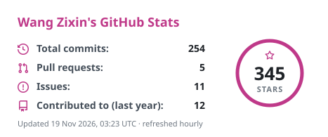

Hi there! 👋 I'm Zixin, but feel free to call me Chris. I'm a first-year **MEng Robotics and Artificial Intelligence** student at **UCL**.

- 🤖 Learning to build robots, with the goal of becoming a robotics engineer
- 🌱 Open-source enthusiast: I build and maintain [**asmr-dubber**](https://github.com/EveningStudy/asmr-dubber), an AI dubbing and subtitle tool, [**books-plus**](https://github.com/EveningStudy/books-plus), a reader that syncs with Apple Books on Windows and macOS, and [**verre**](https://github.com/EveningStudy/verre), a lightweight native UI for local coding agents
- 🧩 Speedcuber who also writes little tools for the cube, like [bld-memo-trainer](https://github.com/EveningStudy/bld-memo-trainer) for blindfolded memo practice

### 📊 GitHub stats

<picture>
  <source media="(prefers-color-scheme: dark)" srcset="https://raw.githubusercontent.com/EveningStudy/EveningStudy/main/profile/stats-dark.svg" />
  
</picture>

### 🤖 Robotics

<table>
  <tr>
    <td align="center" valign="top">
       
      <b>relay-workbench</b> 
      Robot audio · scene fusion
    </td>
    <td align="center" valign="top">
       
      <b>warehouse-inspection-robot</b> 
      ROS 2 · Gazebo · Nav2 · YOLO
    </td>
    <td align="center" valign="top">
       
      <b>pick-place-robot</b> 
      ROS 2 · Panda · MoveIt 2 · RGB-D
    </td>
  </tr>
</table>

### 🧰 Tools people use

<table>
  <tr>
    <td valign="top" width="33%">
      
      <a href="https://github.com/EveningStudy/asmr-dubber"><b>asmr-dubber</b></a>
       
      JA / EN / ZH media → Chinese or English dubbing and subtitles, with voice cloning and vocal separation.  
      
    </td>
    <td valign="top" width="33%">
      
      <a href="https://github.com/EveningStudy/books-plus"><b>books-plus</b></a>
       
      A Windows / macOS reader that syncs with Apple Books: cloud library, progress, notes, read-aloud and desktop subtitles.  
      
    </td>
    <td valign="top" width="33%">
      
      <a href="https://github.com/EveningStudy/verre"><b>verre</b></a>
       
      Lightweight native UI (~14 MB Rust) for Claude Code, Codex, Cursor, Antigravity &amp; 21+ ACP agents — zero injection.  
      
    </td>
  </tr>
</table>

### 📦 More projects

| Project | What it is |
| --- | --- |
| [tailclip](https://github.com/EveningStudy/tailclip) | Private clipboard across Windows, iPhone, iPad and Mac over your own Tailscale network: single-file Python relay, no dependencies |
| [cat-dog-breed-classifier](https://github.com/EveningStudy/cat-dog-breed-classifier) | Cat and dog breed classifier: PyTorch training, ONNX Runtime inference and a Flask web app showing the top 5 results |
| [image-text-redactor](https://github.com/EveningStudy/image-text-redactor) | Finds the text in an image and pixelates all of it, or only the blocks you click |
| [qian-estate](https://github.com/EveningStudy/qian-estate) | Property collaboration platform: WeChat mini-programs for owners and agents, with an admin console and server |
| [fourier-synthesizer](https://github.com/EveningStudy/fourier-synthesizer) | Square, sawtooth and triangle waves built from 1–7 sine harmonics, drawn live on an ST7789 LCD (Verilog, Tang Nano 9K) |
| [st7789-fpga-driver](https://github.com/EveningStudy/st7789-fpga-driver) | SPI driver for a 1.14″ 240×135 ST7789 LCD on the Gowin GW1NR-9C |
| [bili-migrate](https://github.com/EveningStudy/bili-migrate) | Windows CLI that backs up and republishes your own Bilibili videos, metadata and pinned comments |
